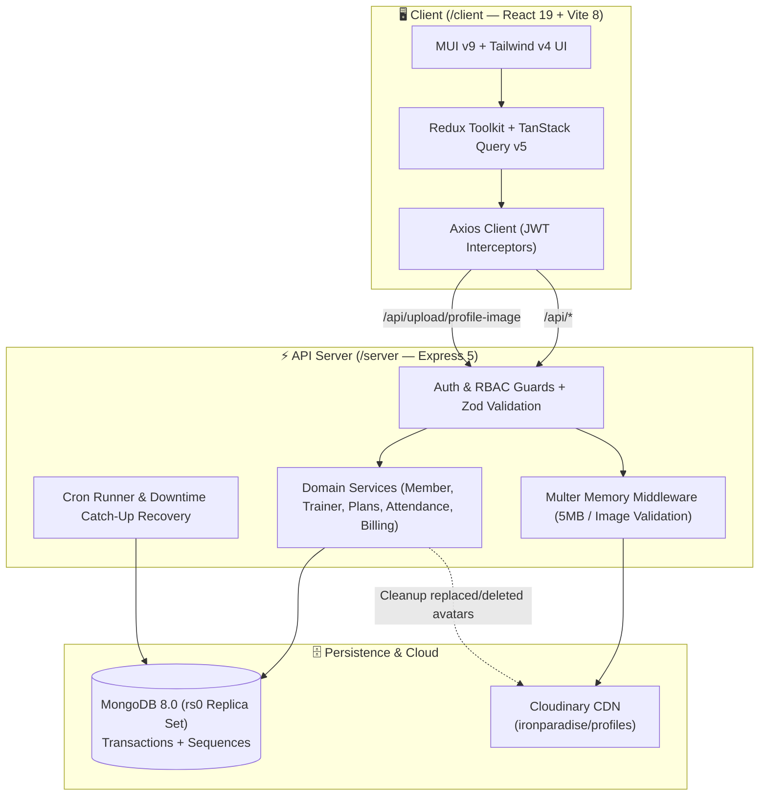
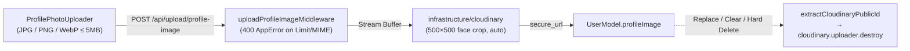

<div align="center">

  

  # IronParadise — Gym Management Platform

  <p><strong>Full-Stack Role-Based Gym Operations, Billing & Fitness Management Suite</strong></p>

  <p>
    Unifying member onboarding, trainer payroll, fitness & diet programming, attendance tracking, billing receipts, Cloudinary media management, and self-healing cron automation in a decoupled React 19 + Express 5 + MongoDB architecture.
  </p>

  <p>
    <a href="https://www.typescriptlang.org/"></a>
    <a href="https://react.dev/"></a>
    <a href="https://expressjs.com/"></a>
    <a href="https://www.mongodb.com/"></a>
    <a href="https://tailwindcss.com/"></a>
    <a href="https://cloudinary.com/"></a>
    <a href="https://www.docker.com/"></a>
  </p>

  <p>
    <b><a href="#-key-modules">Modules</a></b> •
    <b><a href="#-system-architecture">Architecture</a></b> •
    <b><a href="#-tech-stack">Tech Stack</a></b> •
    <b><a href="#-project-structure">Structure</a></b> •
    <b><a href="#-getting-started">Quickstart</a></b> •
    <b><a href="#-scripts--health-checks">Scripts</a></b> •
    <b><a href="#-database--license">Database & License</a></b>
  </p>

</div>

---

## 📑 Table of Contents

<details>
<summary><b>Click to expand / collapse navigation</b></summary>

- [🧩 Key Modules](#-key-modules)
- [🏛 System Architecture](#-system-architecture)
- [🛠 Tech Stack](#-tech-stack)
- [📁 Project Structure](#-project-structure)
- [🏁 Getting Started](#-getting-started)
- [📜 Scripts & Health Checks](#-scripts--health-checks)
- [🗄 Database & License](#-database--license)

</details>

---

## 🧩 Key Modules

<table>
  <tr>
    <td width="33%" valign="top">
      <h3 align="center">🔐 Auth & Role Dashboards</h3>
      <p align="center">
        
        
      </p>
      <ul>
        <li><b>Multi-Role Portals:</b> Tailored dashboards and route guards for <code>admin</code>, <code>trainer</code>, and <code>member</code>.</li>
        <li><b>Dual-Token Sessions:</b> Access + refresh JWTs with <code>bcrypt</code> credential hashing.</li>
        <li><b>Granular Permissions:</b> Module-level admin permissions across operations.</li>
      </ul>
    </td>
    <td width="33%" valign="top">
      <h3 align="center">🏋️ Members & Fitness Plans</h3>
      <p align="center">
        
        
      </p>
      <ul>
        <li><b>Lifecycle Tracking:</b> Member profiles, body measurements, and active assignments.</li>
        <li><b>Plan Management:</b> Configurable membership tiers, diet plans, and workout plans.</li>
        <li><b>Billing & Receipts:</b> Installment tracking, due balances, and printable receipts.</li>
      </ul>
    </td>
    <td width="33%" valign="top">
      <h3 align="center">💼 Trainers & Payroll</h3>
      <p align="center">
        
        
      </p>
      <ul>
        <li><b>Trainer Profiles:</b> Specializations, qualifications, shift timings, and member rosters.</li>
        <li><b>Salary Management:</b> Monthly salary cycles, dues tracking, and payout vouchers.</li>
        <li><b>Trainer Portal:</b> Assigned member attendance and fitness oversight.</li>
      </ul>
    </td>
  </tr>
  <tr>
    <td width="33%" valign="top">
      <h3 align="center">📅 Attendance, Events & Comms</h3>
      <p align="center">
        
      </p>
      <ul>
        <li><b>Attendance Console:</b> Check-in/out entry, daily logs, and duration tracking.</li>
        <li><b>Events & Enquiries:</b> Gym calendar events and lead/enquiry follow-ups.</li>
        <li><b>Messaging:</b> Built-in communication templates and user messaging.</li>
      </ul>
    </td>
    <td width="33%" valign="top">
      <h3 align="center">☁️ Cloudinary Media Pipeline</h3>
      <p align="center">
        
        
      </p>
      <ul>
        <li><b>Zero-Disk Streaming:</b> Validated in-memory buffers streamed directly to Cloudinary.</li>
        <li><b>Smart Transforms:</b> <code>500×500</code> face-centered crop with <code>auto</code> format & quality.</li>
        <li><b>Auto Cleanup:</b> Replaces/clears orphaned Cloudinary assets on update or hard delete.</li>
      </ul>
    </td>
    <td width="33%" valign="top">
      <h3 align="center">⏱ Resilient Cron Engine</h3>
      <p align="center">
        
        
      </p>
      <ul>
        <li><b>3 Automated Jobs:</b> Trainer salary accrual, subscription renewal, nightly checkout.</li>
        <li><b>Downtime Catch-Up:</b> <code>cron-evaluator</code> detects and recovers missed runs on boot.</li>
        <li><b>Graceful Shutdown:</b> Cleanly halts schedules and closes DB connections on SIGTERM.</li>
      </ul>
    </td>
  </tr>
</table>

---

## 🏛 System Architecture



<details>
<summary><b>Click to view: Cloudinary Profile Image Lifecycle</b></summary>



</details>

---

## 🛠 Tech Stack

| Layer | Technologies |
| :--- | :--- |
| **Frontend (`/client`)** | React 19, TypeScript 6, Vite 8, Tailwind CSS v4, MUI v9 (`@mui/material`, Data Grid, Date Pickers), Redux Toolkit, TanStack React Query v5, Axios, Motion, SweetAlert2, Dayjs |
| **Backend (`/server`)** | Node.js 22+, Express 5, TypeScript 6 (`tsx`), MongoDB 8 + Mongoose 9, Zod v4, JWT (`jsonwebtoken`), `bcrypt`, Multer, Cloudinary SDK v2, `node-cron`, `cron-parser` |
| **Tooling & Infra** | `pnpm` (`11.9.0`), Docker & Docker Compose (`mongo:8.0` `rs0` replica set) |

---

## 📁 Project Structure

```text
IronParadise/
├── client/
│   ├── src/
│   │   ├── app/               # Redux store, TanStack Query client, providers
│   │   ├── modules/           # attendance, auth, dashboard, diet-plan, enquiry, event,
│   │   │                      # member, membership-plan, messages, trainer, workout-plan
│   │   ├── shared/            # API service, UI components, hooks, layouts, styles
│   │   ├── App.tsx & main.tsx
│   ├── DockerFile
│   └── vite.config.ts         # Dev port 5151, `@/` alias
├── server/
│   ├── src/
│   │   ├── config/            # env, database, cors, cloudinary
│   │   ├── infrastructure/    # cloudinary/cloudinary.service.ts
│   │   ├── jobs/              # cron schedules, evaluator, recovery & tests
│   │   ├── modules/           # admin, attendance, auth, dashboard, diet-plan, enquiry,
│   │   │                      # event, member, membership-plan, message, trainer,
│   │   │                      # upload, user, workout-plan
│   │   ├── routes/            # `/api` consolidated router
│   │   ├── seeds/             # Database seeder (`pnpm seed`)
│   │   ├── shared/            # middlewares, models, errors, utils, types
│   │   ├── app.ts             # Express app + `/health/cloudinary`
│   │   └── server.ts          # Bootstrap & graceful shutdown
│   ├── DockerFile
│   └── package.json
└── docker-compose.yml         # MongoDB rs0, Backend (6969), Client (5151)
```

---

## 🏁 Getting Started

### Prerequisites

- **Node.js** `v22+`, **pnpm** `v11.9+`
- **MongoDB 8.0** (Replica Set `rs0` enabled for multi-document transactions) or **Docker**
- **Cloudinary** account credentials

### 1. Configure Environment (`server/.env`)

```env
PORT=6969
PROJECT_VERSION=v1.0.2
CLIENT_ORIGIN=http://localhost:5151
MONGO_URI=mongodb://localhost:27017/ironparadise?replicaSet=rs0&directConnection=true

JWT_SECRET=your_jwt_secret
JWT_EXPIRES_IN=1d
JWT_REFRESH_SECRET=your_refresh_secret
JWT_REFRESH_EXPIRES_IN=7d

CLOUDINARY_CLOUD_NAME=your_cloud_name
CLOUDINARY_API_KEY=your_api_key
CLOUDINARY_API_SECRET=your_api_secret
```

> [!NOTE]
> `docker-compose.yml` loads `./server/.env` via `env_file` so Cloudinary credentials are injected automatically into the `backend` container.

### 2. Run the Stack

<details open>
<summary><b>Option A: Docker Compose (Recommended)</b></summary>

```bash
docker compose up --build
```

| Service | URL | Notes |
| :--- | :--- | :--- |
| **Client** | [http://localhost:5151](http://localhost:5151) | Vite React 19 dev server |
| **Backend API** | [http://localhost:6969](http://localhost:6969) | Express 5 API (healthcheck on `/health/cloudinary`) |
| **MongoDB** | `mongodb://localhost:27017` | Single-node `rs0` replica set |

</details>

<details>
<summary><b>Option B: Local Development</b></summary>

```bash
# Backend (http://localhost:6969)
cd server
pnpm install
pnpm seed        # optional: populate sample plans, trainers, members & events
pnpm start

# Frontend (http://localhost:5151)
cd client
pnpm install
pnpm dev
```

</details>

---

## 📜 Scripts & Health Checks

| Command / Endpoint | Scope | Description |
| :--- | :--- | :--- |
| `pnpm test` | `server/` | Runs cron, validation, payment, auth, RBAC, upload, and profile-image suites |
| `pnpm seed` | `server/` | Seeds initial membership/diet/workout plans, trainers, members, and counters |
| `pnpm build` / `pnpm lint` | `client/` | Type-checks (`tsc -b`), builds production bundle, and runs ESLint |
| `GET /health/cloudinary` | Backend | Pings Cloudinary API (`200` when connected, `503` on failure) |

---

## 🗄 Database & License

- **ER Diagram**: [dbdiagram.io/d/IronParadise](https://dbdiagram.io/d/IronParadise-6a316e2e5c789b8acb984007)
- **License**: [GNU General Public License v3.0](LICENSE)
